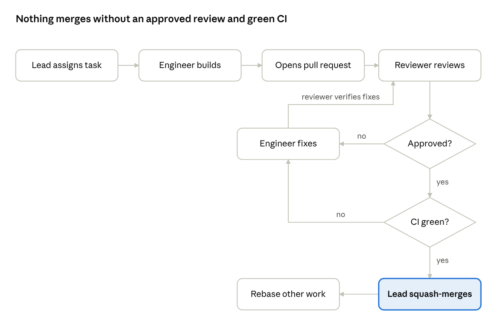
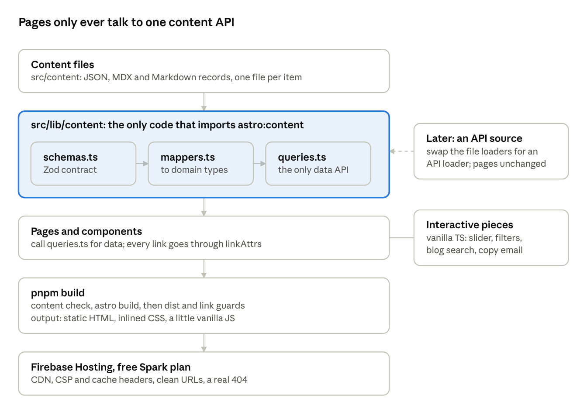
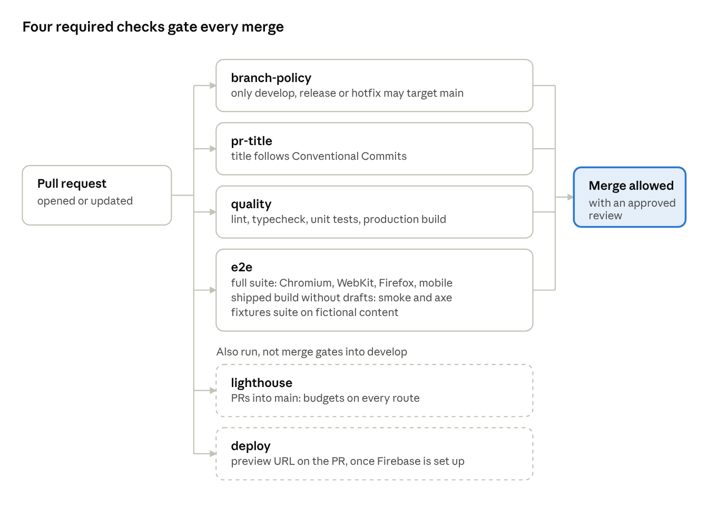

# How AI agents built my developer portfolio

## Why I handed my portfolio to a team of AI agents

My developer portfolio was written, reviewed and merged by AI agents: 25 pull requests in about ten days, each one reviewed before it reached `develop`. I wrote the requirements, made the decisions and approved the plan. The agents did the engineering.

I build Flutter apps and an iOS SDK for a living, not static websites. A portfolio is the side project that never gets finished, so I treated it as an experiment: could an agent team ship it to the standard I'd expect from a human team? That means a spec, architecture decisions on paper, code review on every PR, and a CI pipeline that blocks bad merges.

This post covers how the team is set up, how a change moves from task to merge, the architecture the agents built, and the CI that keeps them honest. It also covers what went wrong, because a fair amount did.

## The team: one lead, one engineer, one reviewer

The team has three roles, each a Claude agent with its own model, tools and written brief. I'm the product owner: I write requirements, make decisions and supply the real content.

| Role            | Model         | Tools                                     | Job                                                                                                       |
| --------------- | ------------- | ----------------------------------------- | --------------------------------------------------------------------------------------------------------- |
| Team lead       | Claude Opus   | Agent, Read, Grep, Glob, Bash             | Plans the work, hands out tasks, routes every PR through review, merges only when review and CI are green |
| Senior engineer | Claude Sonnet | Read, Write, Edit, Grep, Glob, Bash       | Implements one task end to end on its own branch, then fixes every review finding                         |
| PR reviewer     | Claude Opus   | Read, Grep, Glob, Bash (no Write or Edit) | Reviews each PR with fresh context, then verifies the fixes                                               |

A few choices matter more than they look:

- **The reviewer cannot edit code.** Its toolset has no Write or Edit. It can run tests and experiments, but it cannot quietly fix what it finds, so every finding goes back to the engineer as a written report.
- **The reviewer runs on a stronger model than the engineer.** Sonnet is fast and cheap for writing code. Opus is slower and better at doubting it. Review is where I wanted the extra judgement.
- **Everything is repo-scoped.** The agent definitions live in `.claude/agents/` inside the repository, next to a `CLAUDE.md` with the working rules. Nothing is installed globally. Anyone who clones the repo gets the same team.

`CLAUDE.md` holds the rules every agent follows. Commits use Conventional Commits with no AI co-author trailers. Every link goes through one helper. Pages never import the content API directly. And no agent ever invents content: a missing bio line hides the section rather than filling it with plausible text.

The brief for each role is plain Markdown. Here is the top of the reviewer's:

```markdown
---
name: pr-reviewer
description: Independent, skeptical code review of a pull request in this repo
  against the SRS, the design handoff and the repo rules.
tools: Read, Grep, Glob, Bash
model: opus
---

You are a senior front-end reviewer. Review the given PR independently,
do not assume the author's reasoning is correct, and do not rubber-stamp.
```

I started with three engineers working parallel lanes. I later cut that to one, for reasons covered in the lessons section.

## The loop: develop, review, fix, verify, merge

Every change follows the same loop, and nothing reaches `develop` without passing two gates: an approved review and green required CI. The loop came from one sentence I gave the lead: "you develop, raise a PR, the reviewer reviews, you address the feedback, and only when all feedback and required CI pass do you merge."



A "changes requested" verdict loops back to the engineer, and the reviewer re-checks the fix commits; it doesn't re-review the whole PR. A red CI run loops back the same way.

1. **The lead assigns a task.** Every task has an id (PF-12, PF-43) in `docs/IMPLEMENTATION_PLAN.md`, with acceptance criteria tied to the requirements doc. The brief names the design file, what has already merged and what else is in flight.
2. **The engineer builds it on its own branch, in its own clone.** Before opening a PR it must pass lint, type checks, unit tests, the production build and the end-to-end suites locally.
3. **The reviewer reviews with fresh context.** It reads the diff, the plan, the architecture decisions and the design, runs the tests, and writes small experiments to confirm suspicions. Its report has a verdict and a findings table: severity, file and line, the problem, a concrete fix.
4. **The engineer fixes every finding,** including the non-blocking ones, and writes a short note mapping each finding to its change.
5. **The reviewer verifies the fixes.** It often re-applies the original bug to prove the new test now fails, which catches tests that pass no matter what.
6. **The lead merges.** It checks that the verdict is approve, no findings are open, the four required checks pass and the branch is up to date with `develop`. Then it squash-merges and tells other in-flight branches to rebase.

The review report and the fix note are posted as comments on the PR, so the GitHub history shows the whole conversation, not just the final diff.

The reviewer earned its place. On the accessibility PR it showed that two tests still passed after the bug they guarded was put back. On the docs PR it caught a rollback command missing one `@`, which would have failed exactly when the site was broken. On the link checker it found that fonts referenced from inline CSS were never checked.

## The architecture: a static site with one door to the data

The site is Astro 7 with static output, hosted free on Firebase Hosting. It ships no UI framework runtime: about 95% of it is content, and the four interactive pieces (a writing slider, project filters, blog search, a copy-email button) are small vanilla TypeScript modules.

The lead didn't pick this stack by default. It wrote the reasoning down as an architecture decision record (ADR) and listed what it rejected:

- **A React single-page app** would return HTTP 200 for unknown URLs and only fill in page metadata after JavaScript runs, so link previews on LinkedIn or Slack would come out blank.
- **A Next.js static export** pays the cost of hydrating every page.
- **A Node server** needs paid hosting, and I wanted no card on file for v1.



The most important line in the codebase is one ESLint rule: no page or component may import `astro:content`. Everything goes through `src/lib/content/`:

- `schemas.ts` holds the Zod schemas. They are the content contract, and a bad record fails the build with a readable message.
- `mappers.ts` turns raw records into plain domain types such as `Profile`, `Project` and `Article`.
- `queries.ts` is the only data API the pages may call. Sorting, deduplication and "featured" selection live as pure functions in `logic.ts`.

The point is the future backend. ADR-0008 says content will later come from an API, and that must not force a rewrite of the components. When it does, the file loaders get swapped for an API loader behind `queries.ts`, and the pages don't change. `pnpm schemas:export` already writes the contract as JSON Schema for whoever builds that backend.

Nine ADRs record every decision of this weight: the stack and hosting, content format, manual Medium articles, email-only contact in v1, analytics, performance budgets, no custom domain until 1.0, the content abstraction, and the security and cache headers. When an agent proposed something that contradicted one, the reviewer had a document to point at.

## Maintainable, testable, scalable

These three words are easy to put on a slide, so here is what each one means in this repo.

### Maintainable: content is data, and the build refuses bad data

Adding an article or a project means adding one JSON or Markdown file in `src/content/`. No component changes. The schema rejects a record with a missing field, a bad date or a broken reference, and the build stops with the file name and the reason. A content check runs before every build and fails on placeholder text, so a "Lorem ipsum" or "TODO" can't reach production.

`docs/MAINTENANCE.md` covers the routine jobs step by step: add an article, a project, a case study or a job, swap the resume, roll back a bad deploy, rotate tokens. A guard test checks that every script name and file path in the docs still exists, so the docs fail CI when the code moves.

### Testable: logic lives in pure functions, and real content isn't needed to test

Anything with a rule in it (sorting projects, picking featured items, building RSS, generating structured data, deciding if a link is safe) is a pure function in `src/lib/` with unit tests. Coverage on `src/lib` must stay at 90% or above.

One problem surprised me: my real content isn't finished. There are no articles yet and no case studies. A blog page with zero posts can't test search, pagination or the slider. So the agents built a fixtures mode: a set of clearly fictional content in `tests/fixtures/content/` and a separate build that loads it. Every feature gets exercised on fake data, and a guard checks that no fixture text ever leaks into the real build.

| Layer         | Tool                                                             | What it catches                                                                                |
| ------------- | ---------------------------------------------------------------- | ---------------------------------------------------------------------------------------------- |
| Unit          | Vitest, plus the Astro container API to render components        | Logic bugs, schema rules, component output (375 tests)                                         |
| End to end    | Playwright on Chromium, WebKit, Firefox and a Pixel 7 profile    | Broken pages, navigation, headers, keyboard flows, layout shift                                |
| Accessibility | axe-core inside the e2e run, plus a manual WCAG 2.2 AA checklist | Missing names, contrast, focus problems                                                        |
| Performance   | Lighthouse CI on every route                                     | Performance under 0.95, accessibility or SEO under 1, more than 25 KB of JS or 500 KB per page |
| Build guards  | Content check, fixture-leak scan, link checker                   | Placeholders, broken internal links and anchors, unsafe external links                         |

The e2e tests run against the Firebase Hosting emulator, not the Astro dev server. That way they test the real headers, clean URLs and the real 404 status the site will have in production.

### Scalable: in traffic, in content, and toward a backend

- **Traffic.** The output is static files on a CDN, so traffic only costs bandwidth. The free plan caps transfer at about 360 MB a day, which is why the page-weight budget exists: smaller pages mean more visitors before the cap.
- **Content.** Pages are generated from collections, so the 50th article costs the same as the first: one file.
- **Features.** The contact form is already planned as a Cloud Function behind a feature flag (`PUBLIC_CONTACT_FORM`). It turns on when I move to the paid plan, without changing any page.
- **Backend.** The content API boundary above means a CMS or my own API can replace the files later. Only pages that need live data would move to server rendering.

## The CI pipeline: what runs on every pull request

Every push to a PR starts four required jobs on GitHub Actions, and the PR can't merge until all four pass. CI is the second gate after the reviewer, and the one that doesn't take anyone's word for anything, including the reviewer's.



- **branch-policy** enforces the git flow. Feature, fix, chore and content branches go into `develop`; only `develop`, `release/*` and `hotfix/*` may target `main`.
- **pr-title** checks the title is a Conventional Commit. PRs are squash-merged, so the title becomes the commit message, and later the changelog.
- **quality** runs `pnpm install --frozen-lockfile`, lint (ESLint and Prettier), `astro check`, the unit tests with coverage, and the full production build. The build includes the content check, the fixture-leak scan and the link checker, so a broken internal link fails here.
- **e2e** installs Chromium, WebKit and Firefox and runs three passes:
  1. The full Playwright suite against the Firebase emulator, with drafts visible.
  2. The `@smoke` and axe tests on the build that actually ships, with drafts hidden. This catches pages that only work because a draft filled them.
  3. The `@fixtures` suite on the fictional content, which exercises the blog, the slider and the case studies.

The other workflows:

- **lighthouse** runs only on PRs into `main`, so it guards releases without slowing everyday work. It runs Lighthouse CI over every route of the fixtures build (three runs each, judged pessimistically), plus an SEO run on the real indexable build.
- **deploy** publishes each PR to a Firebase preview channel and posts the URL on the PR. `develop` goes to a staging channel and `main` goes live, followed by a smoke test. Until the Firebase secret exists, it skips cleanly instead of failing.
- **links** runs a weekly check that external links still resolve.
- A Claude review workflow is also wired in, and stays switched off until an API key is added.

Before any of this, git hooks (lefthook) run Prettier and ESLint on staged files and commitlint on the commit message, so most problems never leave the laptop. A newer push cancels the in-flight CI run for the same branch, so only the latest commit gets tested.

## What went wrong, and what I'd change

The agents were good, but the setup around them needed fixing more than once. These are the problems that cost the most time.

**A test that passed everywhere except CI.** To stop text jumping when web fonts load, the engineer generated fallback fonts sized to match Inter and Space Grotesk, plus an e2e test checking the widths match within 1%. It passed locally and failed on GitHub's Ubuntu runners, where the fallback for Arial resolves to a different system font and Inter came out 1.66% off. The first fix skipped the test when Arial wasn't really Arial; the runner's font fooled that check too. The final fix kept the precise check where it belongs, in a unit test of the generated numbers, and made the browser test guard what users see: headings wrap onto the same number of lines. Lesson: decide which layer owns a guarantee before writing the test.

**The cloud agents couldn't push to GitHub.** The agents ran in a cloud workspace without write access to my repository, and every push came back 403. The workaround: the agents package each branch as a `git bundle`, the bundle is copied to my Mac, and a small script there pushes it with a token. It worked, but it made my laptop part of the pipeline: when the Mac slept, finished work waited. Next time I'd sort out repository access on day one.

**Three engineers were more than this project needed.** I started with three Sonnet engineers in parallel lanes, each with its own clone and test port. That was fast, but parallel branches touched the same files (security headers and SEO both edited `firebase.json`), so merges needed rebases and conflict fixes. Three engineers and an Opus reviewer also used up my weekly usage limit, and the team stopped until it reset. After that I cut to one engineer working sequentially. For a project this size it was barely slower and much calmer.

**Agents write from memory unless something checks them.** The engineer's browser-support table said Safari supports all of the font metric overrides. It doesn't, and the reviewer caught it against MDN. The reviewer also found tests that kept passing after the bug they guarded was put back. Mutation-style checks ("revert the fix, does the test fail?") became a normal part of verification.

**My own rules had to be written down.** Early commits carried an AI co-author trailer, which I didn't want in my history. I asked for it removed, the history was rewritten, and the rule went into `CLAUDE.md` and each agent brief. Every preference I only said out loud once had to be repeated; the ones in the repo stuck.

**What still needs me.** The agents won't write my bio, invent project results or pick my analytics provider, and they shouldn't. Real content, product decisions, the Firebase account and testing on a real iPhone are mine. The repo makes that explicit: missing content hides a section rather than faking it.

## Was it worth it?

Yes, with one condition: the agents are only as good as the gates around them. The model writing the code mattered less than the review, the CI and the rules written into the repo. Remove any of those and you get code that looks finished and isn't.

What surprised me most was how normal the process felt. Tickets with acceptance criteria, branches, review comments, a red build, a fix, a merge: the same rhythm as a good human team, at a pace I couldn't match alone on evenings and weekends.

The code, the agent definitions, the ADRs and every review comment are public in [the repository](https://github.com/sakib-shadman/developer-portfolio). Fork the `.claude/agents/` folder and `CLAUDE.md`, swap in your own rules, and see how far your agents get. The site itself is next: real content, Firebase, and a v1.0.0 tag.
